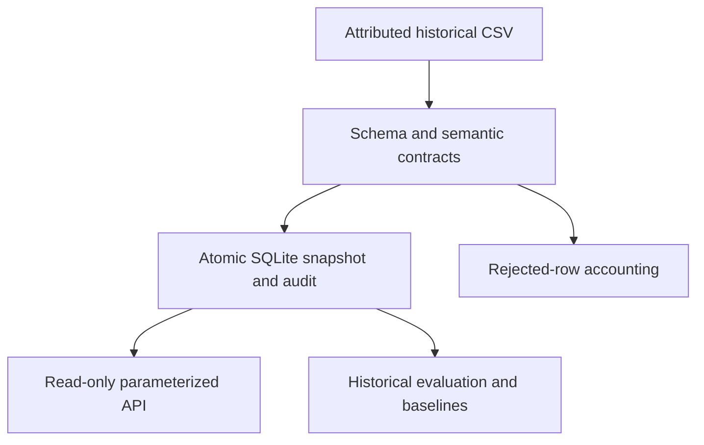

# Mobility Quality Lab

A repeat-safe UCI Bike Sharing pipeline and read-only analytics API with semantic contracts, transactional recovery tests and a rolling-origin historical evaluation.

[](https://github.com/Sunnyvulli/mobility-quality/actions/workflows/verify.yml)

**Inspect:** [interactive recorded portfolio demo](https://sunnyvulli.github.io/#work) · [pipeline audit](results/pipeline.json) · [rolling-origin results](results/temporal-evaluation.json) · [decisions](docs/decisions.md). Local reference system, not a live cloud service.

## Quick start

Python 3.11+ and GNU Make are needed for the dependency-free ingestion/API/test path:

```sh
make run
```

This ingests the complete bundled source into a temporary database twice, verifies 17,379 accepted rows and 3,292,679 represented rentals, and executes 13 tests. No API key, cloud account or package installation is required. Research dependencies are separate:

```sh
python3 -m venv .venv
. .venv/bin/activate
pip install -r requirements.txt
make backtest evaluate
```

For a persistent local API: `python pipeline.py`, then `python api.py`. Inspect `http://127.0.0.1:8080/health` or `/daily?start=2011-01-01&end=2011-01-07`. [Operator guide](OPERATIONS.md).

## Highlights with denominators

- Full attributed hourly source: 17,379 observations, 731 observed dates, 3,292,679 rentals and 165 absent hourly slots within those dates. Missing observations stay missing; valid contracts do not prove observational truth.
- 13 tests: ten system tests and three temporal-protocol tests, including real HTTP, identical replay, observation drift repair, source-byte capture and injected SQLite failure rollback/retry.
- Three expanding-history windows cover 84 whole test days. Calendar-only forest weighted MAE is 49.766 rentals/hour; online weekly-lag MAE is 64.031. The weekly baseline consumes seven-day-old observations as test hours arrive; this is not a fixed 28-day-ahead forecast.
- Retained hashes, package versions, three model seeds, fold boundaries, fallback counts and paired daily errors. [Protocol and limitations](https://github.com/Sunnyvulli/Sunnyvulli.github.io/blob/main/research/temporal-followup.md).

## Architecture



Hashing and parsing use the same captured bytes. Repeated active input is cached only when every stored observation matches the validated input; edited/deleted/extra observations cause transactional replacement under `BEGIN IMMEDIATE`. A trigger-injected failure preserves the prior rows, manifest and active hash; retry is tested. The schema and audit metadata remain trusted. [Decisions](docs/decisions.md).

## Container path

```sh
docker compose up --build --wait
```

The image builds the real-data snapshot and runs the tests; the API runs as UID 10001. Compose publishes only to host loopback, makes the filesystem read-only, drops capabilities and supplies temporary scratch space. Stop with `docker compose down`. The standalone CI must pass its actual image/HTTP/non-root tests before this import is called verified. A container is not an AWS deployment.

## Failure analysis and limits

Plausible but wrong values can satisfy category/calendar/count contracts. Snapshot consistency cannot prove that historical observations are correct. Full-file reads, complete replay comparisons, SQLite single-writer locking and a loopback API are deliberate local limits; no distributed throughput, authentication, TLS or cloud scaling is demonstrated. JSON export occurs after the SQLite transaction; export failure does not roll the database back. Retrospective weather-assisted estimates are distinct from the calendar-only rolling-origin study. [Study draft](https://github.com/Sunnyvulli/Sunnyvulli.github.io/blob/main/research/mobility-study.md) is unpublished and not peer-reviewed.

## Maintenance, provenance and roadmap

The implementation was imported from the owner's portfolio repository after its existing checks passed. The source history remains there; [source commit and per-file hashes](docs/import-provenance.json) identify the import. Root setup/CI/Compose paths are adapted here; existing portfolio paths remain compatible while links move to this standalone home. No original history is rewritten or backdated.

Next: independent-source validation and calibrated seasonal drift checks, followed by a separately authorized cloud integration. [Changelog](CHANGELOG.md) · [Contributing](CONTRIBUTING.md) · [Teaching sample](https://github.com/Sunnyvulli/Sunnyvulli.github.io/blob/main/teaching/data-reliability-lab.md).

## Attribution

UCI Bike Sharing, 2011–2012, CC BY 4.0: [source/license/hash](data/SOURCE.md). MIT software license. Established Python/scikit-learn algorithms are not claimed as original or worldwide novel. Research context: [Breck et al., Data Validation for Machine Learning, MLSys 2019](https://mlsys.org/Conferences/2019/doc/2019/167.pdf).
